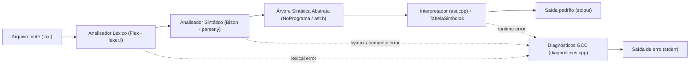
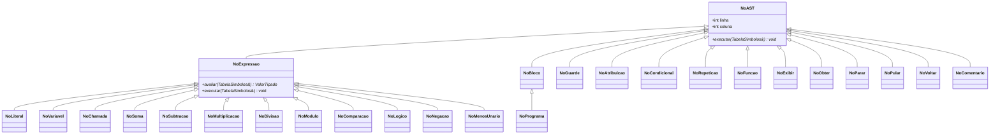

# Arquitetura Técnica e Decisões de Implementação — Interpretador Oxítona

Este documento detalha a arquitetura interna do interpretador da linguagem **Oxítona** (C++17, Flex e Bison) e justifica as principais decisões de projeto adotadas pela equipe.

---

## 1. Visão Geral do Pipeline

O interpretador executa em duas etapas encadeadas no processo principal (`main.cpp`):



### Módulos do Projeto

| Arquivo | Responsabilidade |
| :--- | :--- |
| `main.cpp` | Parsing de argumentos de linha de comando (`--debug`/`-g`, `--help`/`-h`), abertura do arquivo fonte, invocação de `yyparse()`, criação da `TabelaSimbolos` raiz, execução de `arvore_raiz->executar(tabela)`, captura de exceções de execução e liberação da AST. |
| `lexer.l` | Especificação Flex: reconhecimento de tokens UTF-8, rastreamento de linha/coluna via `YY_USER_ACTION` e emissão de `lexical error` para caracteres inválidos. |
| `parser.y` | Gramática LALR(1) no Bison, ações semânticas que constroem a AST, anotação de linha/coluna em cada comando (`com_linha`), desaçucaramento de `ou se` (`como_alternativa`), validação estática dos especificadores de `obter` e tratamento de `yyerror`. |
| `ast.h` | Declaração dos tipos (`TipoDado`, `Valor`, `ValorTipado`), da `TabelaSimbolos` e de toda a hierarquia de nós da AST (`NoAST`, `NoExpressao` e subclasses). |
| `ast.cpp` | Implementação dos métodos `executar()` e `avaliar()`, regras semânticas de tipos/conversões, controle de fluxo via exceções internas e operações de E/S. |
| `diagnosticos.h` / `diagnosticos.cpp` | Formatação centralizada de erros no padrão GCC (`caminho:linha:coluna: error: categoria: mensagem`), recorte da linha fonte com expansão de tabulações, marcador `^` e exibição opcional de `note: parser:` no modo `--debug`. |
| `Makefile` | Automação de geração (`bison -d`, `flex`), compilação C++17 (`g++ -std=c++17`), geração dos binários `oxitona` e `oxi`, execução dos testes (`make test`) e limpeza (`make clean`). |

---

## 2. Árvore Sintática Abstrata (AST)

Todos os elementos executáveis da linguagem herdam de `NoAST`, que armazena metadados de localização (`linha` e `coluna`) e define a interface polimórfica de execução. Expressões herdam de `NoExpressao`, especializando a interface com `avaliar(TabelaSimbolos&)`.



### Decisões de Implementação da AST

1. **Dualidade de `NoChamada`:** `NoChamada` herda de `NoExpressao` (que implementa `executar()` delegando para `avaliar()`). Isso permite usar o mesmo nó tanto em expressões (`exibir(soma(7, 5))!`) quanto como instrução isolada (`saudacao("Ana")!`) sem duplicação de código.
2. **Desaçucaramento de `ou se` em `parser.y` (`como_alternativa`):** em vez de criar uma classe separada ou um vetor de pares `(condição, bloco)` dentro de `NoCondicional`, cada ramo `ou se` é reduzido no parser a um `NoCondicional` aninhado dentro de um `NoBloco` sintético passado como ramo `senao` do condicional anterior.
   - **Vantagens:** preserva `NoCondicional` enxuto, mantém desalocação automática em cascata no destrutor e garante que `NoBloco::executar` atualize `linha_execucao_atual` e `coluna_execucao_atual` para a linha exata do `ou se` antes de avaliar sua condição.
3. **Gerenciamento de memória:** cada nó é dono exclusivo dos ponteiros filhos que recebe e os destrói recursivamente em seu destrutor virtual (`~NoAST()`). Ao término da execução (sucesso ou erro), `main.cpp` executa `delete arvore_raiz`, liberando toda a árvore.

---

## 3. Padrão de Projeto: Interpreter

Na proposta inicial (Etapa 1), mencionou-se o padrão *Visitor*. Durante a implementação, a equipe optou deliberadamente pelo padrão **Interpreter**, no qual cada nó da AST encapsula sua própria lógica de avaliação (`avaliar`) ou execução (`executar`).

**Justificativa da decisão:**
- O projeto possui uma única operação principal sobre a AST (interpretação direta), sem múltiplos passes independentes (como otimização ou geração de código de máquina).
- Com o padrão **Interpreter**, adicionar uma nova construção na linguagem exige apenas criar a classe do nó em `ast.h`/`ast.cpp` e a regra correspondente em `parser.y`, evitando o *boilerplate* de duplo despacho (`accept`/`visit`) do *Visitor*.

### Controle de Fluxo por Exceções Internas

Em `ast.cpp`, os desvios estruturados de fluxo são modelados por três structs privadas derivadas de `std::runtime_error`:
- `SinalParar` (`parar!`) e `SinalPular` (`pular!`): lançadas por `NoParar`/`NoPular` e interceptadas exclusivamente pelo `try/catch` de `NoRepeticao::executar`.
- `SinalRetorno` (`voltar!`): carrega `bool possui_valor` e `ValorTipado valor`, sendo interceptada por `NoFuncao::chamar`, que valida compatibilidade com o tipo de retorno declarado da função.

**Benefício:** desenrola automaticamente todos os blocos e escopos aninhados intermediários (`NoBloco`, `NoCondicional`) com segurança de exceções e, caso qualquer uma dessas instruções seja usada fora de contexto (ex.: `parar!` fora de `repetir`), a própria exceção chega ao `catch` de `main.cpp` com mensagem de erro clara.

---

## 4. Tabela de Símbolos e Sistema de Valores

A classe `TabelaSimbolos` (`ast.h` / `ast.cpp`) gerencia variáveis e funções em tempo de execução:

- **Representação segura de tipos em C++17:** cada variável armazena um `ValorTipado` composto por `TipoDado` (`enum class`) e `Valor = std::variant<int, double, bool, std::string, std::monostate>`. O uso de `std::variant` substitui uniões inseguras de C, garantindo verificação estrita de tipo via `std::holds_alternative` e `std::get`.
- **Cadeia de escopos (`TabelaSimbolos* pai`):**
  - Cada `NoBloco::executar` instancia `TabelaSimbolos escopo_local(&t)` na pilha de execução.
  - Cada `NoFuncao::chamar` instancia `TabelaSimbolos local(&pai_tabela)` e vincula os parâmetros formais nesse escopo antes de executar o corpo da função.
  - Operações de busca (`existe`, `obter`, `atribuir`, `obter_funcao`) percorrem a cadeia `pai` de dentro para fora; `definir` impede sombreamento/redeclaração de nomes já existentes na cadeia de escopos visíveis.
- **Armazenamento de funções:** `std::map<std::string, NoFuncao*> funcoes` registra ponteiros não-proprietários para os nós `NoFuncao` já pertencentes à AST.

---

## 5. Tratamento de Erros e Sistema de Diagnósticos

O módulo `diagnosticos.h` / `diagnosticos.cpp` padroniza todos os erros emitidos pelo interpretador no formato inspirado no GCC:

```text
<arquivo>:<linha>:<coluna>: error: <categoria>: <mensagem>
 <linha> | <trecho do código-fonte com tabs expandidos>
         | <espaços>^
```

### Categorias de Erro

| Categoria | Origem | Exemplo |
| :--- | :--- | :--- |
| `file error` | `main.cpp` | Arquivo `.oxi` inexistente ou sem permissão de leitura |
| `lexical error` | `lexer.l` | Caractere inválido fora do alfabeto da linguagem (ex.: `@`) |
| `syntax error` | `parser.y` (`yyerror`) | Token inesperado ou ausente (ex.: `ou se` sem `senão`, ausência de `!`) |
| `semantic error` | `parser.y` (regra `entrada`) | Especificador inválido ou contagem incompatível em `obter` |
| `runtime error` | `ast.cpp` → `main.cpp` | Tipos incompatíveis, divisão por zero, variável/função não declarada, condição não-`sinal`, função sem retorno |

### Rastreamento Preciso de Localização e Modo `--debug`

1. **Colunas UTF-8 no Flex (`lexer.l`):** a macro `YY_USER_ACTION` atualiza `yylloc` ignorando bytes de continuação UTF-8 (`(caractere & 0xC0) != 0x80`) e expandindo tabulações em múltiplos de 8 colunas, garantindo que o marcador `^` aponte exatamente para o caractere ofensivo mesmo em linhas com acentos (`fração`, `senão`, `textão`, `sermão`).
2. **Propagação para tempo de execução:** o parser anota `linha` e `coluna` em cada comando da AST via `com_linha(...)`. Antes de executar cada comando em `NoBloco::executar`, as variáveis globais `linha_execucao_atual` e `coluna_execucao_atual` são atualizadas; quando uma exceção é lançada em `ast.cpp`, `main.cpp` usa essas coordenadas para exibir o recorte exato do código-fonte.
3. **Modo `--debug` / `-g`:** habilitado via flag na linha de comando, acrescenta a linha `note: parser: <detalhe do Bison>` em erros sintáticos (alimentado por `%define parse.error verbose` em `parser.y`), mantendo a saída padrão limpa e didática para uso normal.
